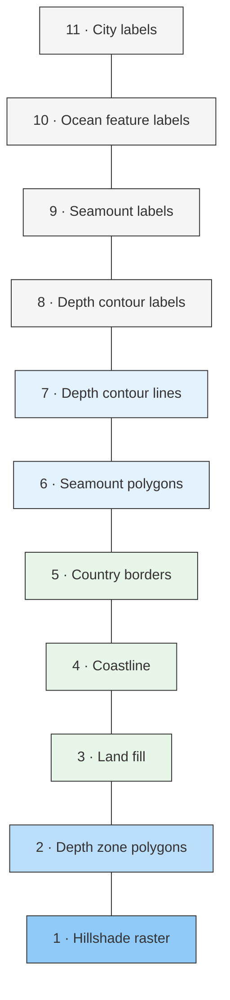

# Architecture

## Design Philosophy

OceanStream Basemap uses a **hybrid rendering** approach: raster hillshade provides grayscale 3D
relief, while vector tiles deliver crisp depth colors, contours, and labels at any zoom level.
This avoids the washed-out look of traditional baked-color bathymetric tiles.

---

## Rendering Stack

MapLibre GL composites the layers bottom-to-top:



The style definition lives in `styles/OceanBasemapStyle.ts` and is consumed by any MapLibre GL
application that registers the PMTiles protocol beforehand.

---

## Data Flow Detail

### Raster Path

1. **Download** 8 GEBCO 2026 quarter-hemisphere tiles from CEDA (~7.5 GB total)
2. **Merge** into a single `GEBCO_2026.tif` with `gdal_merge.py`
3. **Hillshade**: multi-directional hillshade → gamma correction (γ = 0.55) → PNG tiles (z0–10)
4. **Hypsometric**: land-only DEM → EMODnet-style color relief → PNG tiles (z0–8)

### Vector Path

1. **Depth Polygons**: reclassify GEBCO into 14 depth zones → downsample to 220 m → polygonize → PMTiles
2. **Contours**: downsample to 500 m / 1 km → extract at 1000 m / 500 m / 200 m / shallow intervals → filter ocean-only → multi-layer PMTiles
3. **Ocean Labels**: Natural Earth marine polygons + SCUFN gazetteer → merge with zoom mapping → PMTiles
4. **Seamounts**: GSFM shapefile → extract seamount features → clean properties → PMTiles
5. **Land Tiles**: Natural Earth (110 m / 10 m) + OSM land + coastline → multi-resolution PMTiles with land, coastline, countries, cities layers

### Delivery

All tiles are uploaded to S3 via `aws s3 sync` (raster trees) and `aws s3 cp` (PMTiles). The
MapLibre style references the public base URL
`https://oceanstream-bucket.s3.waw3-1.cloudferro.com/basemap`.

---

## Directory Layout

```
/media/andrei/RP60/oceanstream/basemap/
└── gebco2026/
    ├── GEBCO_2026.tif              # Merged source DEM
    ├── work/                       # Intermediate files
    │   ├── hillshade_multi.tif
    │   ├── hillshade_gamma.tif
    │   ├── gebco_depth_zones.tif
    │   ├── depth_zones.fgb
    │   ├── contours/
    │   ├── labels/
    │   ├── seamounts/
    │   ├── land/
    │   └── hypsometric/
    └── tiles/                      # Final outputs
        ├── hillshade/              # PNG tile tree
        ├── hypsometric/            # PNG tile tree
        ├── depth_zones.pmtiles
        ├── depth_contours.pmtiles
        ├── ocean_labels.pmtiles
        ├── seamounts.pmtiles
        └── land_base.pmtiles
```
