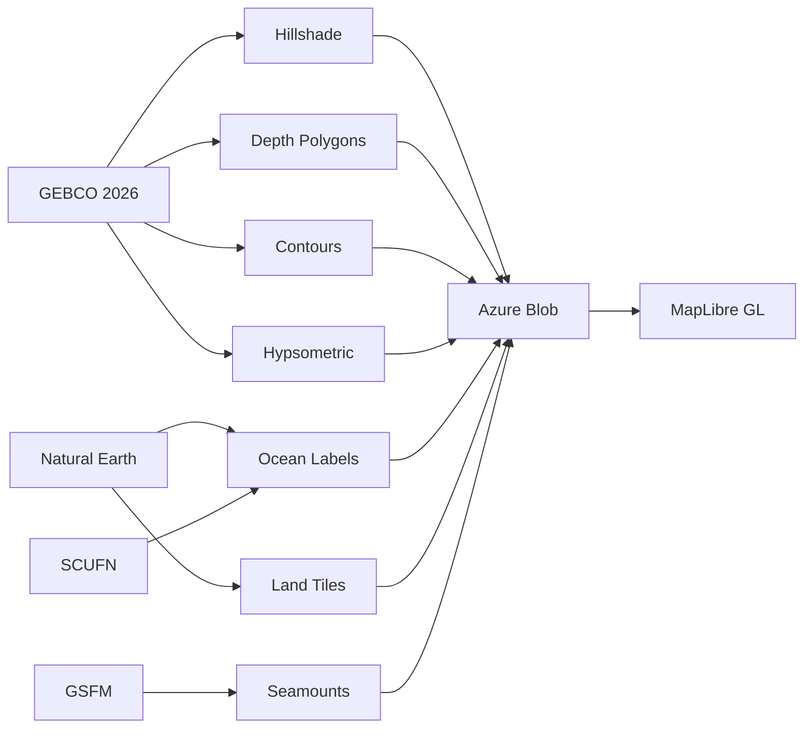

<div class="hero" markdown>

# OceanStream Basemap

An open-source, GEBCO-based ocean basemap pipeline.
Raster hillshade for 3D texture, vector polygons for crisp depth color, vector contours and labels — all in one.

</div>

---

## Why Hybrid?

Traditional ocean basemaps bake color into the hillshade raster, which looks washed out at most zoom levels. OceanStream uses the same **hybrid approach as Mapbox Bathymetry v2**:

| Layer | Format | Purpose |
|-------|--------|---------|
| Hillshade | Raster PNG tiles | Grayscale 3D relief texture only |
| Depth zones | Vector PMTiles | Crisp, zoom-independent depth coloring |
| Contours | Vector PMTiles | Labeled depth isolines |
| Labels | Vector PMTiles | Ocean features, cities, seamounts |

The result: **pixel-perfect color at any zoom**, with hillshade providing subtle relief underneath.

## Layer Stack

Rendered bottom-to-top in MapLibre GL:

| # | Layer | Source |
|---|-------|--------|
| 1 | Hillshade raster (z0–8) | GEBCO 2026 → `gdal2tiles` → Azure Blob |
| 2 | Depth zone polygons | GEBCO 2026 → reclassify → `tippecanoe` → PMTiles |
| 2b | Depth zones (Europe, z6+) | *Optional.* EMODnet DTM → reclassify → `tippecanoe` → PMTiles |
| 2c | Depth zones (HR coastal, z10+) | *Optional.* EMODnet HR-DTMs → reclassify → `tippecanoe` → PMTiles |
| 3 | Land fill | Natural Earth + OSM → PMTiles |
| 4 | Coastline | Natural Earth + OSM → PMTiles |
| 5 | Country borders | Natural Earth → PMTiles |
| 6 | Seamount polygons | GSFM (Harris et al. 2014) → PMTiles |
| 7 | Depth contour lines | GEBCO 2026 → `gdal_contour` → PMTiles |
| 8 | Depth contour labels | Along-line symbol placement |
| 9 | Seamount labels | GSFM name property |
| 10 | Ocean feature labels | Natural Earth + SCUFN Gazetteer → PMTiles |
| 11 | City labels | Natural Earth populated places |

## Get Started

### Prerequisites

Install [uv](https://docs.astral.sh/uv/) (Python package manager), GDAL, and Tippecanoe:

=== "macOS"

    ```bash
    # uv
    brew install uv

    # GDAL and Tippecanoe
    brew install gdal tippecanoe
    ```

=== "Ubuntu / Debian"

    ```bash
    # uv
    curl -LsSf https://astral.sh/uv/install.sh | sh

    # GDAL
    sudo apt-get update
    sudo apt-get install -y gdal-bin libgdal-dev

    # Tippecanoe (build from source)
    sudo apt-get install -y build-essential libsqlite3-dev zlib1g-dev
    git clone https://github.com/felt/tippecanoe.git
    cd tippecanoe && make -j && sudo make install
    ```

=== "Windows (WSL2)"

    ```bash
    # Install WSL2 with Ubuntu, then follow the Ubuntu instructions above
    wsl --install

    # Inside WSL2:
    curl -LsSf https://astral.sh/uv/install.sh | sh
    sudo apt-get update
    sudo apt-get install -y gdal-bin libgdal-dev build-essential libsqlite3-dev zlib1g-dev
    git clone https://github.com/felt/tippecanoe.git
    cd tippecanoe && make -j && sudo make install
    ```

Verify installations:

```bash
uv --version       # uv 0.6+
gdalinfo --version  # GDAL 3.12+
tippecanoe --version
```

### Install & Run

```bash
# Install the basemap CLI
uv sync

# Check pipeline status
oceanbase status

# Run a single step
oceanbase run download

# Run the full pipeline
oceanbase run all

# Start local tile viewer
oceanbase serve
```

### Pipeline at a Glance



## Project Structure

```
basemap/
├── src/basemap/              # Python package
│   ├── cli.py                # Typer CLI (run, status, serve, viewer)
│   ├── config.py             # URLs, checksums, constants
│   ├── pipeline/             # 9 pipeline step modules
│   ├── processing/           # Reclassify, labels, seamount cleaning
│   ├── utils/                # GDAL wrappers, downloads, paths
│   ├── viewer/               # Interactive tile viewer (HTML/JS/CSS)
│   └── server/               # Local tile server
├── styles/                   # MapLibre GL style (TypeScript)
├── scripts/                  # Original bash scripts (reference)
├── docs/                     # This documentation
└── tests/                    # pytest test suite
```

## Data Sources

This project builds on openly available geospatial datasets. See the full [Data Sources & Attribution](data-sources.md) page for licenses and citations.

| Dataset | Provider | License |
|---------|----------|---------|
| GEBCO 2026 Grid | GEBCO / BODC | Public domain |
| EMODnet Bathymetry DTM | EMODnet Bathymetry Consortium | Free use with attribution |
| Natural Earth | NACIS | Public domain |
| SCUFN Gazetteer | IHO / NOAA NCEI | Free for research |
| GSFM Seamounts | Harris et al. (2014) | CC-BY 4.0 |
| OSM Coastlines | OpenStreetMap contributors | ODbL |
| Protomaps Fonts | Protomaps / Google | OFL (Noto) |
