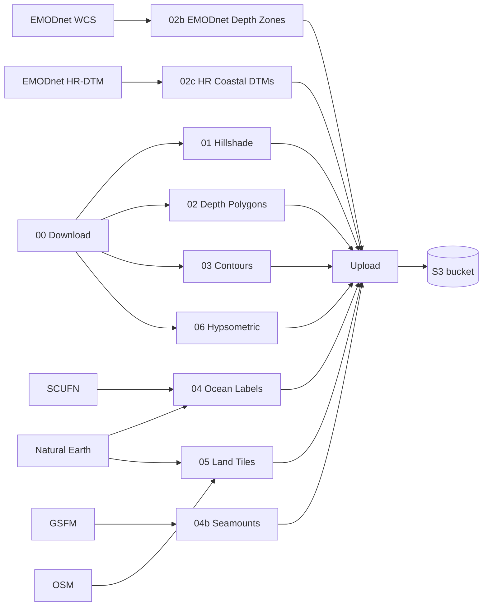

# Pipeline Overview

The basemap pipeline transforms raw geospatial data into optimized map tiles through 9 sequential
steps. Each step is idempotent — it skips work if outputs already exist.

## Steps

| # | Step | Input | Output | Tools |
|---|------|-------|--------|-------|
| 00 | [Download GEBCO](download.md) | CEDA Archive | `GEBCO_2026.tif` | httpx, gdal_merge |
| 01 | [Hillshade](hillshade.md) | GEBCO_2026.tif | `hillshade/` PNG tiles | gdaldem, gdal_calc, gdal2tiles |
| 02 | [Depth Polygons](depth-polygons.md) | GEBCO_2026.tif | `depth_zones.pmtiles` | rasterio, gdalwarp, gdal_polygonize, tippecanoe |
| 02b | [EMODnet Depth Zones](emodnet.md) | EMODnet WCS | `depth_zones_eu.pmtiles` | httpx, gdalbuildvrt, rasterio, tippecanoe |
| 02c | [HR Coastal DTMs](hr-bathymetry.md) | EMODnet HR-DTM index | `depth_zones_hr.pmtiles` | httpx, rasterio, gdal_polygonize, tippecanoe |
| 03 | [Contours](contours.md) | GEBCO_2026.tif | `depth_contours.pmtiles` | gdalwarp, gdal_contour, tippecanoe |
| 04 | [Ocean Labels](ocean-labels.md) | Natural Earth, SCUFN | `ocean_labels.pmtiles` | httpx, fiona, tippecanoe |
| 04b | [Seamounts](seamounts.md) | GSFM archive | `seamounts.pmtiles` | fiona, ogr2ogr, tippecanoe |
| 05 | [Land Tiles](land-tiles.md) | Natural Earth, OSM | `land_base.pmtiles` | ogr2ogr, tippecanoe |
| 05b | [Sea Mask](sea-mask.md) | OSM land polygons | `sea_mask.pmtiles` | shapely, ogr2ogr, tippecanoe |
| 05c | [Lakes](lakes.md) | HydroLAKES, GEBCO | `lakes.pmtiles`, `lake_relief*.pmtiles` | fiona, rasterio, tippecanoe |
| 05d | Boundaries | Natural Earth | `boundaries.pmtiles` | ogr2ogr, tippecanoe |
| 02f | [NCEI CUDEM](cudem.md) | NOAA NCEI | `work/cudem/grids/` | httpx, rasterio |
| 02g | [AusBathyTopo](ausbathytopo.md) | Geoscience Australia | `work/ausbathytopo/grids/` | rasterio |
| 05f | [Land Cover](worldcover.md) | ESA WorldCover 2021 | `work/cover/worldcover*.vrt` | rasterio |
| 05g | [Rivers](rivers.md) | the MERIT network (05h) | `rivers.pmtiles`, `work/land/rivers.fgb` | fiona, tippecanoe |
| 06 | [Land Relief](hypsometric.md) | Copernicus DEM, GEBCO, WorldCover, GSW | `land_relief*.pmtiles` | httpx, gdalbuildvrt, rasterio, Pillow |
| 07 | [Continuous Bathymetry](bathymetry.md) | GEBCO, EMODnet DTM, HR grids | `bathy_*.pmtiles` | rasterio, shapely, Pillow |
| — | [Upload](upload.md) | All tile outputs | S3 object storage | aws CLI |

Steps 02b and 02c are **opt-in**: they cover European seas only and pull tens of gigabytes, so
`oceanbase run all` skips them unless you ask for them.

## Execution

```bash
# Run a single step
oceanbase run download
oceanbase run hillshade

# Run the full pipeline in order
oceanbase run all

# Add the opt-in regional steps
oceanbase run all --with emodnet --with hr-bathymetry
oceanbase run all --with all
```

All steps share a common pattern:

1. Resolve the data directory (`$BASEMAP_DATA_DIR`, or `~/basemap-data`)
2. Check for existing outputs (skip if present)
3. Process data with GDAL / rasterio / tippecanoe
4. Write outputs to `gebco2026/tiles/`

## Data Flow



## Output Directory

After a full run, the tile directory contains:

```
gebco2026/tiles/
├── hillshade/          # Raster PNG tile tree (z0–10)
├── hypsometric/        # Raster PNG tile tree (z0–8)
├── depth_zones.pmtiles
├── depth_zones_eu.pmtiles
├── depth_zones_hr.pmtiles
├── depth_contours.pmtiles
├── ocean_labels.pmtiles
├── seamounts.pmtiles
└── land_base.pmtiles
```
