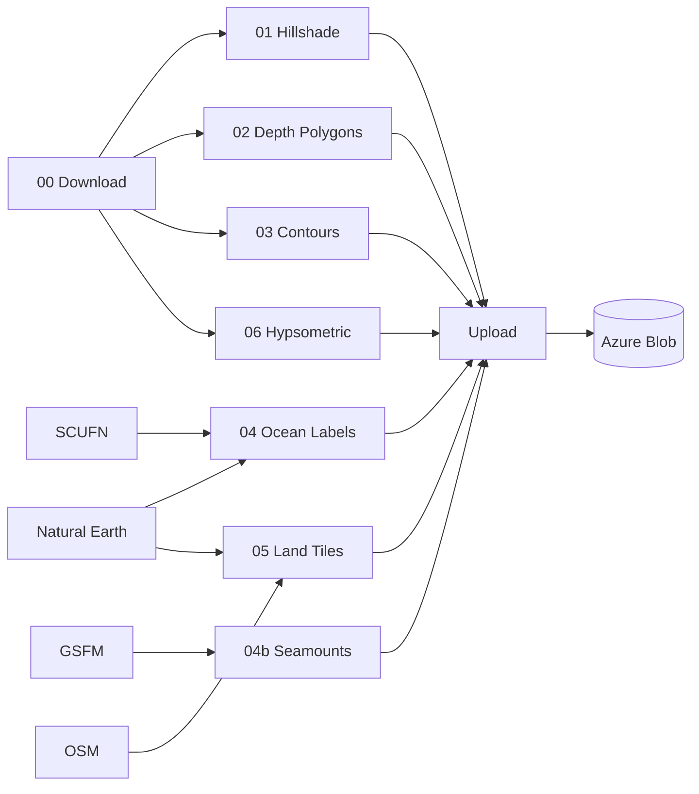

# Pipeline Overview

The basemap pipeline transforms raw geospatial data into optimized map tiles through 9 sequential
steps. Each step is idempotent — it skips work if outputs already exist.

## Steps

| # | Step | Input | Output | Tools |
|---|------|-------|--------|-------|
| 00 | [Download GEBCO](download.md) | CEDA Archive | `GEBCO_2025.tif` | httpx, gdal_merge |
| 01 | [Hillshade](hillshade.md) | GEBCO_2025.tif | `hillshade/` PNG tiles | gdaldem, gdal_calc, gdal2tiles |
| 02 | [Depth Polygons](depth-polygons.md) | GEBCO_2025.tif | `depth_zones.pmtiles` | rasterio, gdalwarp, gdal_polygonize, tippecanoe |
| 03 | [Contours](contours.md) | GEBCO_2025.tif | `depth_contours.pmtiles` | gdalwarp, gdal_contour, tippecanoe |
| 04 | [Ocean Labels](ocean-labels.md) | Natural Earth, SCUFN | `ocean_labels.pmtiles` | httpx, fiona, tippecanoe |
| 04b | [Seamounts](seamounts.md) | GSFM archive | `seamounts.pmtiles` | fiona, ogr2ogr, tippecanoe |
| 05 | [Land Tiles](land-tiles.md) | Natural Earth, OSM | `land_base.pmtiles` | ogr2ogr, tippecanoe |
| 06 | [Hypsometric](hypsometric.md) | GEBCO_2026.tif | `hypsometric/` PNG tiles | gdaldem, gdal_calc, gdal2tiles |
| — | [Upload](upload.md) | All tile outputs | Azure Blob Storage | az CLI |

## Execution

```bash
# Run a single step
oceanbase run download
oceanbase run hillshade

# Run the full pipeline in order
oceanbase run all
```

All steps share a common pattern:

1. Resolve the data directory (`$BASEMAP_DATA_DIR` or `/media/andrei/RP60/oceanstream/basemap`)
2. Check for existing outputs (skip if present)
3. Process data with GDAL / rasterio / tippecanoe
4. Write outputs to `gebco2026/tiles/`

## Data Flow



## Output Directory

After a full run, the tile directory contains:

```
gebco2026/tiles/
├── hillshade/          # Raster PNG tile tree (z0–10)
├── hypsometric/        # Raster PNG tile tree (z0–8)
├── depth_zones.pmtiles
├── depth_contours.pmtiles
├── ocean_labels.pmtiles
├── seamounts.pmtiles
└── land_base.pmtiles
```
